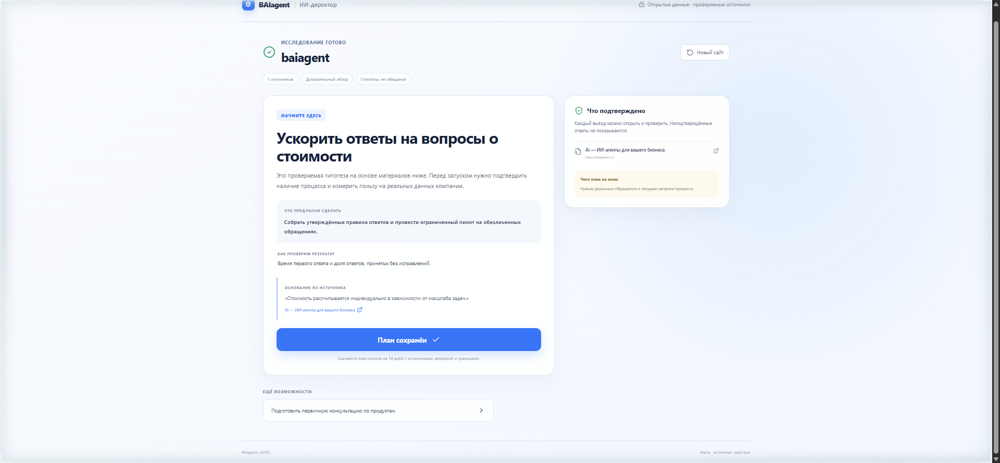

# BAIagent Director

**Бесплатный ИИ-советник для бизнеса: компания, рынок, локальные документы и проверяемый следующий шаг.**

Укажите сайт компании. Director исследует открытые страницы и внешние упоминания, отделяет факты от гипотез, показывает источники и помогает сформировать измеримый пилот. Windows-версия дополнительно работает с выбранными документами и локальной моделью.

[Открыть веб-аудит](https://baiagent.ru/xray/) · [Скачать Director 0.8.1](https://baiagent.ru/xray/downloads/BAIagent-Director-Setup-Windows-0.8.1-x64.exe) · [Страница бесплатной версии](https://baiagent.ru/free/)



## Возможности

- Первичное знакомство с компанией по одному сайту, без длинной анкеты.
- Исследование товаров, услуг, цен, конкурентов, отзывов и рыночных сигналов с адресами источников.
- Причинные гипотезы: наблюдение → механизм → действие → способ проверки.
- Конкретный пилот с метрикой, неизвестными и границами, а не обещание автоматической прибыли.
- Локальный диалог и документы в Windows: TXT, Markdown, CSV, JSON, PDF и DOCX.
- Qwen через существующую локальную Ollama или загружаемая модель Qwen3-4B — без обязательного облачного API-ключа.
- Подбор решения из проверенного каталога BAIagent после определения задачи. Справочные рекомендации не равны уже внедрённому автономному агенту.
- Режимы BAIagent, веб-аудита и расширенного enterprise-аудита Balanov.PRO на общей кодовой базе.

## Границы продукта

Director — советник, а не автономный сотрудник: он не выполняет операции в CRM сам. Рекомендации остаются гипотезами до проверки реальными данными. Цитата подтверждает наличие текста в источнике, но не истинность утверждения источника или коммерческую ценность идеи.

Свежий рыночный сбор требует интернет. Локальный диалог и сохранённые материалы могут использоваться без сети. Веб-версия не заявляет локальный запуск Qwen в браузере.

## Установка для Windows

[Скачать BAIagent Director 0.8.1 x64](https://baiagent.ru/xray/downloads/BAIagent-Director-Setup-Windows-0.8.1-x64.exe)

**SHA-256:** `d45c528e34f8b9d6f8a7ae034e5ba71f8e99cb41e23e793ea97b4754633d91dd`

Публичный установщик скачан и сверен с этой контрольной суммой перед подготовкой GitHub-релиза. Он пока не имеет Authenticode-подписи, поэтому Windows может предупредить о неизвестном издателе.

При первом запуске без готовой Ollama приложение может загрузить около 2,4 ГБ модели. Оставьте запас места на диске; рекомендуется 8 ГБ RAM или больше.

## Разработка

Требуется Node.js 24 и npm.

```bash
npm ci
npm run electron:dev
```

Проверки и сборки:

```bash
npm test
npm run build
npm run build:xray
npm run build:advisor
npm run build:enterprise
```

Перед публикацией пройдены **161 автотест** и все пять перечисленных команд сборки/проверки. Для desktop, веб- и enterprise-режимов используются разные точки входа и серверные контуры; не следует считать их возможности взаимозаменяемыми.

Пакеты desktop:

```bash
npm run dist:win
npm run dist:linux  # на Linux
npm run dist:mac    # на macOS
```

Workflow `.github/workflows/release.yml` собирает Windows, Linux и macOS на соответствующих runners и прикрепляет артефакты к теговому релизу. Наличие workflow не означает, что macOS-пакет нотаризован или все платформы проверены вручную.

## Веб-развёртывание

```bash
npm run build:xray
```

Содержимое `dist/` развёртывается в `/xray/` на PHP 8.1+ с cURL, DOM и SimpleXML. Браузер обращается к `/xray/api/research.php`; облачный ключ модели для этого маршрута не нужен.

Enterprise-режим собирается через `npm run build:enterprise` в `dist-enterprise/` с базовым путём `/ai-audit/`.

## Структура

```text
src/             React-интерфейс и результаты аудита
electron/        изолированный desktop-контур, локальные файлы и Qwen
shared/          исследования, доказательства, рекомендации и пилоты
public/api/      PHP-контур публичного исследования
scripts/         сборка и проверки
tests/           автоматические регрессионные проверки
android/         нативный Android-прототип
docs/images/     изображения документации
```

## Безопасность и лицензия

См. [SECURITY.md](SECURITY.md), [ROADMAP.md](ROADMAP.md) и [LAUNCH.md](LAUNCH.md).

Код: [AGPL-3.0-or-later](LICENSE). Qwen и сторонние зависимости сохраняют собственные лицензии.
